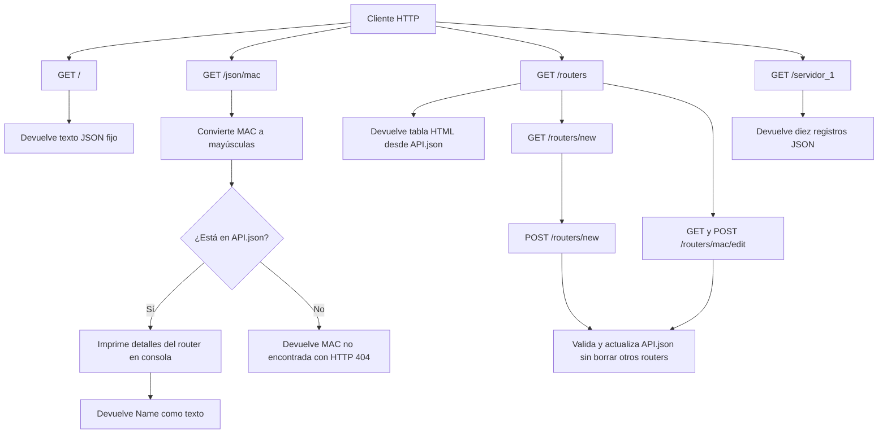

# API Flask de red

Aplicación Flask con consultas de routers desde un archivo JSON y un inventario estático de servidores. Este documento describe el comportamiento actual para servir como referencia en el desarrollo futuro.

## Estructura del proyecto

| Ruta | Descripción |
| --- | --- |
| `app.py` | Aplicación Flask y definición de las rutas HTTP. |
| `API.json` | Datos de routers indexados por identificadores tipo MAC. |
| `templates/` | Plantillas HTML para la tabla de routers y el formulario de alta/edición. |
| `Unidad1/` | Ejercicios y actividades de Python. |
| `Unidad2/` | Directorio actualmente vacío. |
| `req.txt`, `req.tx` | Archivos actualmente vacíos; no declaran dependencias. |
| `venv/` | Entorno virtual local; no debe incluirse en Git. |

## Ejecución local

Desde la carpeta raíz del proyecto, instala Flask en el entorno de Python activo e inicia el servidor:

```powershell
python -m pip install Flask
python app.py
```

La aplicación se inicia en `http://127.0.0.1:5000` con el modo debug activado. Ejecuta `app.py` desde la raíz del proyecto porque `API.json` se abre mediante una ruta relativa. El modo debug es solo para desarrollo local.

## Rutas HTTP

Las rutas de consulta usan `GET`. El formulario usa `GET` para mostrarse y `POST` para guardar.

| Método | URL | Comportamiento |
| --- | --- | --- |
| `GET` | `/` | Devuelve el valor JSON de texto `"3D:RF:09:7F::"`. Es un identificador fijo; no consulta un router. |
| `GET` | `/json/<mac>` | Convierte el parámetro a mayúsculas y busca el router en `API.json`. Si existe, imprime nombre, protocolos, estado y VLANs en la consola, y devuelve el campo `Name` como texto. Si no existe, responde `MAC no encontrada` con estado HTTP `404`. |
| `GET` | `/routers` | Muestra una tabla HTML con los routers cargados desde `API.json`. El icono `+` abre el formulario de alta y el lápiz abre el formulario para editar ese router. |
| `GET` | `/routers/new` | Muestra el formulario para agregar un router, con campos para MAC, nombre, protocolos, estado y una o más VLANs. |
| `POST` | `/routers/new` | Valida y agrega un nuevo router a `API.json` sin reemplazar los demás registros. |
| `GET` | `/routers/<mac>/edit` | Muestra el formulario con los datos existentes del router. |
| `POST` | `/routers/<mac>/edit` | Valida y actualiza el router en `API.json`; permite cambiar su MAC si no está asignada a otro registro. |
| `GET` | `/servidor_1` | Devuelve en JSON diez servidores estáticos, con IDs desde `0001` hasta `0010`. |

Los cambios a `API.json` se guardan mediante un archivo temporal y reemplazo atómico. Si los datos no pasan la validación o el archivo no se puede guardar, se muestra un error y no se confirma el cambio. El formulario permite agregar varias VLANs; `Protocolos`, `Ports` y `Policies` aceptan valores separados por comas o saltos de línea.

### Validación del formulario

Los campos se validan tanto en el navegador como en el servidor; la validación del servidor es obligatoria aunque el cliente no ejecute JavaScript. Las reglas son:

| Campo | Formato aceptado |
| --- | --- |
| MAC | Seis pares alfanuméricos separados por dos puntos, por ejemplo `3D:RF:09:7F:00:00`. Se conserva el formato MAC-like de los datos existentes, que puede incluir letras fuera de `A-F`. |
| Nombre | De 1 a 50 letras (incluye letras latinas acentuadas), números, espacios, puntos, guiones o guiones bajos. |
| Estado | Solo `online` u `offline`. |
| VLAN | Identificador de 1 a 32 caracteres; inicia con una letra y continúa con letras, números, guion o guion bajo. No se permiten nombres de VLAN repetidos. |
| IP | Campo opcional; si se especifica, debe ser IPv4 válida, con octetos entre `0` y `255` (por ejemplo `192.168.1.1`). |
| Protocolos y políticas | Cada elemento inicia con una letra y contiene hasta 32 letras, números, guiones o guiones bajos. |
| Puertos | Cada elemento inicia con una letra y contiene hasta 32 letras, números, barras `/` o guiones. |
| ET y SSH | Solo los booleanos `true` o `false`. |

En forma de expresión regular, el servidor aplica estos patrones (anclados al valor completo mediante `fullmatch`):

```text
MAC:       [A-Za-z0-9]{2}(?::[A-Za-z0-9]{2}){5}
Nombre:    [A-Za-zÀ-ÖØ-öø-ÿ0-9][A-Za-zÀ-ÖØ-öø-ÿ0-9 _.-]{0,49}
VLAN:      [A-Za-z][A-Za-z0-9_-]{0,31}
Protocolo/Política: [A-Za-z][A-Za-z0-9_-]{0,31}
Puerto:    [A-Za-z][A-Za-z0-9/-]{0,31}
IPv4:      (?:25[0-5]|2[0-4]\d|1\d\d|[1-9]?\d)(?:\.(?:25[0-5]|2[0-4]\d|1\d\d|[1-9]?\d)){3}
```

`API.json` ya contiene un registro con la IP `10.300.0.39`, que no es una IPv4 válida. Al editar ese router, hay que corregir la IP o dejar el campo opcional vacío antes de enviar el formulario.

### URLs de ejemplo

- Inicio: `http://127.0.0.1:5000/`
- Router `R0`: `http://127.0.0.1:5000/json/3D:RF:09:7F:00:00`
- Router inexistente (404): `http://127.0.0.1:5000/json/unknown`
- Tabla de routers: `http://127.0.0.1:5000/routers`
- Alta de router: `http://127.0.0.1:5000/routers/new`
- Edición de router: `http://127.0.0.1:5000/routers/3D:RF:09:7F:00:00/edit`
- Inventario de servidores: `http://127.0.0.1:5000/servidor_1`

## Datos de routers

`API.json` es un objeto cuyas claves son identificadores tipo MAC. Cada router contiene `Name`, `Protocolos`, `estatus` y `VLANs`. Los datos de VLAN pueden incluir `Ports`, `Policies`, `ET`, `IP` y `SSH`. La búsqueda no distingue mayúsculas de minúsculas porque la ruta convierte el parámetro a mayúsculas. En una consulta exitosa, el cliente recibe solo el nombre; los demás campos se imprimen en la consola de la aplicación.

## Inventario de servidores

La respuesta de `GET /servidor_1` es un objeto JSON cuyas claves son IDs de servidor y cuyos registros contienen `nombre`, `ip`, `politica` y `estado`.

| ID | Nombre | IP | Política | Estado |
| --- | --- | --- | --- | --- |
| `0001` | `Servidor-Web-01` | `192.168.1.50` | `Permitir-HTTP-HTTPS` | `Activo` |
| `0002` | `BaseDeDatos-Master` | `192.168.1.51` | `Solo-Acceso-Interno` | `Activo` |
| `0003` | `Servidor-Archivos-01` | `192.168.1.52` | `Solo-Acceso-Interno` | `Activo` |
| `0004` | `Servidor-DNS-01` | `192.168.1.53` | `DNS-UDP-TCP` | `Activo` |
| `0005` | `Servidor-Aplicaciones-01` | `192.168.1.54` | `Permitir-HTTP-HTTPS` | `Activo` |
| `0006` | `Servidor-Backup-01` | `192.168.1.55` | `Solo-Acceso-Interno` | `Activo` |
| `0007` | `Servidor-Monitoreo-01` | `192.168.1.56` | `Solo-Acceso-Interno` | `Activo` |
| `0008` | `Servidor-Correo-01` | `192.168.1.57` | `Permitir-SMTP-IMAP` | `Activo` |
| `0009` | `Servidor-Proxy-01` | `192.168.1.58` | `Filtrado-Web` | `Activo` |
| `0010` | `Servidor-Desarrollo-01` | `192.168.1.59` | `Acceso-Desarrollo` | `Activo` |

## Mapa de rutas



## Ramas de Git

En la última revisión, el trabajo local estaba en `feature/FlaskV01` y se publicó en la rama remota `release` del repositorio [HectorTorres070121/Flask](https://github.com/HectorTorres070121/Flask/tree/release). Los nombres de ramas pueden cambiar con el tiempo; consulta Git para conocer el estado actual.
